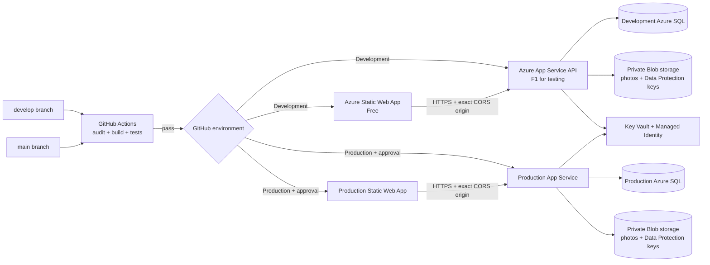

# ListLift Azure Deployment Setup

This guide prepares the **Development** deployment first. A `main` push is wired to the GitHub `Production` environment, but that environment must stay disabled until paid hosting, persistent storage, identity, and production hardening are ready. Deployment is gated by repository-level variables `AZURE_DEV_DEPLOY_ENABLED` and `AZURE_PROD_DEPLOY_ENABLED`; leave both unset or `false` until ready.

## Azure layout



The Blazor client is deployed separately from the ASP.NET Core API. Its API URL is injected into the published static `appsettings.json` for each GitHub environment, and the workflow updates the Content Security Policy's API origin to match. The API must allow the exact corresponding Static Web App origin through `Cors:AllowedOrigins`.

## 1. Check the test-tier cost and create a budget

In the Azure portal, select the subscription you intend to use. Create a monthly budget with email alerts before provisioning resources. A budget sends alerts; it does **not** stop services or cap charges. Azure Cost Management can take time to report usage, so review the current price for your subscription and region before creating each resource. [Microsoft's budget guide](https://learn.microsoft.com/en-us/azure/cost-management-billing/costs/tutorial-acm-create-budgets)

For Azure App Service, the free plan is named **F1**. It is shared, limited to 60 CPU minutes per day, 1 GB memory and 1 GB storage, and has no SLA. It is for trials and learning; Microsoft's pricing page says free/shared plans aren't supported for production workloads. **Basic B1 is paid**, not the free tier. Always On is only available starting at Basic, so ListLift's in-process expiry worker may sleep or run late on F1. [App Service pricing](https://azure.microsoft.com/en-us/pricing/details/app-service/windows/), [Always On settings](https://learn.microsoft.com/en-us/azure/app-service/configure-common)

Azure SQL has a free serverless offer with up to 100,000 vCore-seconds and 32 GB per database per month for eligible accounts. Confirm the offer and usage limits in your subscription; usage outside the free quota can be billed. [Azure SQL pricing](https://azure.microsoft.com/en-us/pricing/details/azure-sql-database/single/)

## 2. Prepare the GitHub repository

1. Create a GitHub repository with the visibility and MIT license already selected for ListLift. Do not add another README, `.gitignore`, or license; these are already in the local repository.
2. Add the repository as `origin`, then push `main` and `develop` after the `develop` branch is created:

   ```powershell
   git remote add origin https://github.com/<OWNER>/<REPOSITORY>.git
   git push -u origin main
   git push -u origin develop
   ```

3. In GitHub, open **Settings → Environments** and create environments named exactly `Development` and `Production`.
4. Restrict `Development` to the `develop` branch. Restrict `Production` to `main` and require an approval reviewer if available for the repository/account plan.
5. Add the variables and secrets described in the next section.
6. Protect `main` with the CI check required and use pull requests from `develop` to `main`.

No GitHub remote is currently configured, and nothing has been pushed.

## 3. Create Azure resources for Development

Use an Azure region available to you in the UK, for example UK South or UK West. Availability and price vary by service and subscription.

1. Create a resource group such as `rg-listlift-dev`.
2. Create one **Windows App Service Plan, F1 Free**, and a .NET 10 Web App for the API. Use a unique API name such as `listlift-api-dev`. Keep it single-instance for this test environment.
3. Create an **Azure Static Web App, Free** for the Blazor client, with GitHub deployment disabled or source set to `Other` so the existing workflow controls deployment. Record its default HTTPS URL and deployment token.
4. Create an Azure SQL logical server and one Development database using the eligible free serverless offer. Set a Microsoft Entra administrator. Do not open the SQL firewall to all networks. For an initial test, allow only the App Service's outbound IPs; review the rules if the app plan or network changes.
5. Create a Storage account with private containers for `listing-photos` and `data-protection`. Disable anonymous blob access. Keep Development storage separate from any future Production storage.
6. Create a Key Vault for Development secrets and a separate vault for Production when Production is eventually provisioned.
7. Create an Application Insights resource for Development and connect it to the API App Service.

The Azure Blob containers and Key Vault are listed as target resources, but ListLift's current source still uses private local-file photo storage and has not yet configured the Azure Blob/Data Protection providers. **Do not enable Azure deployment for photo testing until that adapter work is complete.** The Azure App Service file system is not a substitute for application-owned durable photo storage.

## 4. Configure API identity and settings

1. In the API App Service, open **Identity** and turn on the system-assigned managed identity.
2. In Azure SQL, create a database principal for that managed identity and grant only the permissions the Development app needs. The current Development-only migration service applies pending migrations at startup, so the Development identity needs migration permissions on the Development database. Do not reuse this permission model for Production.
3. Assign the API identity **Storage Blob Data Contributor** on the Development photo and Data Protection containers when the Blob storage implementation is ready. Use a scope limited to the containers where possible. Microsoft recommends managed identities and role-based access control for service-to-service access. [Managed identity for Azure SQL](https://learn.microsoft.com/en-us/azure/azure-sql/database/azure-sql-dotnet-entity-framework-core-quickstart), [Blob role assignment](https://learn.microsoft.com/en-us/azure/storage/common/multiple-identity-scenarios)
4. Grant the API identity access to the Development Key Vault. Put the admin credential hash and any eBay credentials there; never put them in source, a client setting, or a workflow file. The laptop DPAPI credential file can remain on the laptop and be sent by the admin helper over HTTPS; configure `Admin__CredentialHash` in the Azure API environment from the matching hash.
5. In **App Service → Settings → Environment variables**, configure:

   | Setting | Development value |
   |---|---|
   | `ASPNETCORE_ENVIRONMENT` | `Development` |
   | `ConnectionStrings__ListingDb` | `Server=tcp:<server>.database.windows.net,1433;Initial Catalog=<database>;Encrypt=True;TrustServerCertificate=False;Authentication=Active Directory Default;` |
   | `Cors__AllowedOrigins__0` | Exact Development Static Web App origin, e.g. `https://<dev-site>.azurestaticapps.net` |
   | `Admin__CredentialHash` | Key Vault reference for the admin hash, once vault access is configured |
   | `APPLICATIONINSIGHTS_CONNECTION_STRING` | The Development Application Insights connection string |

   App Service settings are injected as environment variables and override app configuration. Use Key Vault references for secret values where possible. [App Service configuration](https://learn.microsoft.com/en-us/azure/app-service/configure-common)

6. Confirm the app starts and `/health` returns HTTP 200. The current health route checks that the API process responds; it does not prove the database, Blob storage, or eBay are healthy.

## 5. Set up GitHub Actions OIDC and environment values

Create a Microsoft Entra application/service principal for GitHub Actions and configure federated credentials for these subjects:

```text
repo:<OWNER>/<REPOSITORY>:environment:Development
repo:<OWNER>/<REPOSITORY>:environment:Production
```

Do not create a client secret for the workflow. Grant the Development identity only the Azure role needed to deploy the Development Web App, scoped to that app. Use a separate Production identity and scope when Production is provisioned. Microsoft recommends OIDC short-lived tokens for GitHub Actions instead of long-lived publish credentials. [Deploy App Service with GitHub Actions](https://learn.microsoft.com/en-us/azure/app-service/deploy-github-actions)

In **Settings → Secrets and variables → Actions → Variables**, create repository-level deployment gates:

| Variable | Initial value |
|---|---|
| `AZURE_DEV_DEPLOY_ENABLED` | `false`; change to `true` only when Development prerequisites are complete |
| `AZURE_PROD_DEPLOY_ENABLED` | Keep `false` or unset until a suitable Production plan and launch readiness are complete |

Configure these **GitHub environment variables** in `Development`:

| Variable | Example |
|---|---|
| `AZURE_CLIENT_ID` | Entra application/client ID used by OIDC |
| `AZURE_TENANT_ID` | Entra tenant ID |
| `AZURE_SUBSCRIPTION_ID` | Azure subscription ID |
| `AZURE_WEBAPP_NAME` | `listlift-api-dev` |
| `LISTLIFT_API_BASE_URL` | `https://listlift-api-dev.azurewebsites.net/` |
| `LISTLIFT_FRONTEND_URL` | Full HTTPS URL of the Development Static Web App |

Configure this **GitHub environment secret** in `Development`:

| Secret | Value |
|---|---|
| `AZURE_STATIC_WEB_APPS_API_TOKEN` | Deployment token for the Development Static Web App |

Create the same variables and secret in `Production` only when that environment is approved and provisioned. Keep `AZURE_PROD_DEPLOY_ENABLED` false or unset for now. Use distinct app names, identities, SQL databases, Storage containers, Key Vaults, and deployment tokens for the two environments.

## 6. Deployment behavior

- Pushes and pull requests to `main` or `develop` run restore, NuGet advisory audit, Release build, and all tests.
- A successful push to `develop` creates one API package and one Blazor client package, then deploys them only if repository variable `AZURE_DEV_DEPLOY_ENABLED=true`.
- A successful push to `main` uses the `Production` environment, which should require reviewer approval. Its job is disabled until repository variable `AZURE_PROD_DEPLOY_ENABLED=true`.
- The API package is the same artifact produced after CI. The Blazor package is the same published client output with only its public API URL and CSP origin adjusted for the target environment.
- The workflow deploys the API, checks `/health`, deploys the static client, and checks its front-page URL.

## 7. Production gates before enabling Production

Do not enable Production deployment on the F1 test setup. Before a real Production launch:

- Move to an App Service tier suitable for the workload; F1 has no SLA and cannot keep ListLift's hosted expiry worker always on. Always On starts at Basic. Consider moving expiry cleanup into a separate scheduled Azure Function so it runs independently of web traffic.
- Implement Blob-backed photo storage and persistent, encrypted Data Protection key storage. Store key-ring material in a private Blob container and protect it with a Key Vault key. ASP.NET Core's external key persistence needs explicit protection at rest and a stable application name across instances. [ASP.NET Core Data Protection key storage](https://learn.microsoft.com/en-gb/aspnet/core/security/data-protection/implementation/key-storage-providers?view=aspnetcore-10.0)
- Use a controlled, one-time Production migration step. The current migration hosted service deliberately skips non-Development environments; do not enable automatic migrations in every Production instance.
- Replace LocalDB and Development CORS settings with the Production SQL database and exact Production Static Web App origin.
- Finish email confirmation/recovery, paid entitlement checks, account/MFA protections, backups, retention, and the admin/eBay secret process before opening the app to public users.

## Rollback

Keep the previous successful API package and deployment commit available. If a deployment fails its health check, redeploy the previous API/client artifacts and inspect Application Insights. Do not reverse a database migration unless it has a reviewed rollback path and a restorable backup.
