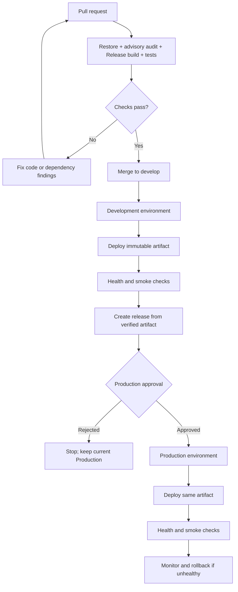

# ListLift CI/CD plan

## Current pipeline status

`.github/workflows/ci.yml` validates pull requests and pushes to `main` and `develop`. It restores with NuGet auditing, builds the solution in Release, and runs the four test projects. It does not deploy the application.

The deploy target is intentionally undecided. Choose the hosting provider, database, private photo store, secret store, and persistent Data Protection key storage before adding deployment credentials or deploy jobs.

## Target flow

## Environment separation

| Resource | Development | Production |
|---|---|---|
| Deployment source | `develop` branch after CI passes | Protected release tag or approved `main` commit |
| GitHub environment | `Development` | `Production`, with required reviewers and branch restrictions |
| Database | Separate non-production database and disposable/sample data | Separate production database with backup and restore plan |
| Secrets | Development-only credentials and endpoints | Production-only credentials; no secret reuse from Development |
| Photo storage | Separate private container/bucket with short retention | Separate private storage with encryption, backup/retention, and access logs |
| Data Protection | Persistent Development key ring | Independently stored and protected Production key ring; access limited to the app identity |
| Marketplace | eBay Sandbox or disabled; no real customer publication | Disabled until seller authorization, paid access, and a human-approved launch plan exist |
| Database migrations | Automated deployment step after backup/validation | Reviewed migration bundle/script, backup, approval, one controlled execution |
| Rollback | Redeploy previous artifact | Redeploy previous artifact; roll back schema only when the migration is explicitly reversible |

## Pipeline requirements

1. Keep CI free of production credentials. Use a read-only `GITHUB_TOKEN`; upload only sanitized test/build artifacts.
2. Keep Development deployment automatic only after CI passes. Run database migration once as a deployment operation, not concurrently from every app instance.
3. Promote the exact artifact already smoke-tested in Development; do not rebuild different bits for Production.
4. Protect `main`, require CI checks, and require Production environment approval. Configure separate environment secrets and branch restrictions in GitHub.
5. Prefer GitHub OIDC/federated identity for the chosen cloud provider instead of long-lived cloud client secrets, where supported.
6. Run a post-deploy health check and a small authenticated smoke suite with a dedicated non-production test account. Do not run tests that create/delete data in Production.
7. Store connection strings, eBay keys, payment credentials, DPAPI-equivalent admin material, and signing material only in the selected secret store. Never expose secrets to the Blazor WebAssembly client.
8. Configure data backups, restore drills, storage retention, alerting, and a rollback playbook before Production deployment.

GitHub environment approvals and secrets are governed by repository visibility and plan. Confirm the account's plan before relying on required reviewers for a private repository; see [GitHub environment availability](https://docs.github.com/en/actions/how-tos/deploy/configure-and-manage-deployments/manage-environments). GitHub recommends pinning third-party actions to full commit SHAs for stronger supply-chain protection; review/pin the workflow actions before Production use using the [secure use reference](https://docs.github.com/en/actions/reference/security/secure-use).
