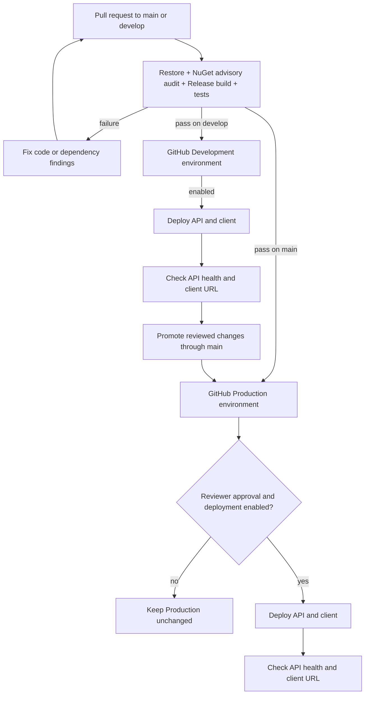

# ListLift CI/CD plan

## Current pipeline status

`.github/workflows/ci.yml` validates pull requests and pushes to `main` and `develop`. After successful CI on a branch push, it packages the API and Blazor client and can deploy them to Azure. Deployment is gated by repository variables `AZURE_DEV_DEPLOY_ENABLED` and `AZURE_PROD_DEPLOY_ENABLED`. Azure resources and GitHub credentials still need to be configured manually.

The selected Azure test target is App Service for the API, Static Web Apps for the client, Azure SQL, private Blob Storage, Key Vault, and Application Insights. See [AZURE_DEPLOYMENT.md](AZURE_DEPLOYMENT.md) for the setup procedure. Start with Development. Keep Production disabled until the application and hosting tier are ready.

## Deployment flow

The API artifact is produced by the CI job and reused by the selected deployment job. The Blazor static output is also produced by CI; at deployment, the workflow changes only `ApiBaseUrl` and the Content Security Policy origin to match the target environment.

## Environment separation

| Resource | Development | Production |
|---|---|---|
| Git source | `develop` branch after CI passes | `main` after CI and reviewer approval |
| GitHub environment | `Development` | `Production`, with branch restrictions and a required reviewer where available |
| Azure API | Separate App Service | Separate App Service |
| Client | Separate Static Web App | Separate Static Web App |
| Database | Development Azure SQL database and disposable data | Separate Production database with backups and restore plan |
| Secrets and identities | Development-only GitHub OIDC identity, Azure identity, Key Vault, and deployment token | Separate Production identities, Key Vault, and token; never reuse Development credentials |
| Photo storage | Private Development Blob container | Separate private Production Blob container with retention and access logging |
| Data Protection | Persistent Development key ring, protected with Key Vault | Separate persistent Production key ring, protected with Key Vault |
| Marketplace | eBay disabled or test credentials | Disabled until paid access, seller authorization, and human-approved launch plan exist |
| Migrations | Current Development service applies migrations on startup | Reviewed one-time migration job after backup; not from each API instance |
| Rollback | Redeploy previous artifact | Redeploy previous artifact; restore database or reverse schema only through reviewed plan |

For zero-cost trial work, provision Development only. The workflow creates a `Production` job path, but `AZURE_PROD_DEPLOY_ENABLED` must remain false or unset until Production resources and security requirements are ready.

## Pipeline and security requirements

1. Keep production credentials out of CI. Use a read-only `GITHUB_TOKEN`; Azure App Service deploys use GitHub OIDC short-lived tokens, not publish profiles or client secrets.
2. Keep Development deployment automatic only after CI passes. Treat schema changes as a single deployment operation, not an action performed concurrently by every Production instance.
3. Require CI for pull requests and protect `main`. Restrict `Development` to `develop` and `Production` to `main`.
4. Require reviewer approval before Production. Keep repository variable `AZURE_PROD_DEPLOY_ENABLED` false until the service tier and production readiness work are complete.
5. Run post-deploy health checks. `/health` currently checks only that the API process responds; add authenticated smoke tests and dependency health checks later.
6. Keep database connection settings, eBay keys, payment credentials, and admin credential hash out of source and the Blazor client. Prefer Managed Identity and Key Vault references for Azure service connectivity and secrets.
7. Configure backups, restore drills, storage retention, alerting, and rollback steps before Production deployment.
8. Pin third-party GitHub Actions to full commit SHAs before Production use. The current workflow uses major-version tags for maintainability during the initial test setup.

## Free testing limits

Azure App Service F1 is a shared trial tier with 60 CPU minutes per day, 1 GB memory, 1 GB storage, and no SLA; Microsoft does not support it for production workloads. It does not provide Always On, so ListLift's in-process expiration worker may run late after app idle/unload. A scheduled Azure Function should own cleanup before production use. Azure SQL has a free serverless offer subject to monthly vCore-second and storage quotas. Storage, Key Vault, and monitoring can still incur charges. Configure Cost Management budget alerts; they notify but do not stop resources.

## Provider references

- [Azure deployment setup](AZURE_DEPLOYMENT.md)
- [App Service GitHub Actions and OIDC](https://learn.microsoft.com/en-us/azure/app-service/deploy-github-actions)
- [Azure SQL with App Service Managed Identity](https://learn.microsoft.com/en-us/azure/azure-sql/database/azure-sql-dotnet-entity-framework-core-quickstart)
- [App Service settings](https://learn.microsoft.com/en-us/azure/app-service/configure-common)
- [App Service F1 plan details](https://azure.microsoft.com/en-us/pricing/details/app-service/windows/)
- [Azure SQL free offer and pricing](https://azure.microsoft.com/en-us/pricing/details/azure-sql-database/single/)
- [Azure budget alerts](https://learn.microsoft.com/en-us/azure/cost-management-billing/costs/tutorial-acm-create-budgets)
