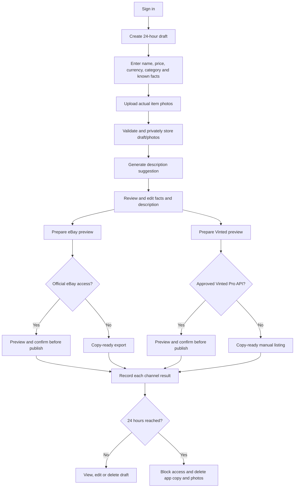

# ListLift — Product Listing Assistant

## Project goal

Build a secure web app where a user enters product details, uploads real photos, reviews an AI-written description, and prepares channel-specific listings for two marketplaces. The app keeps its working draft and photos for **24 hours**, then expires and deletes them.

The first planned channels are eBay and Vinted, subject to account/API eligibility. A user reviews and confirms every listing before it is sent. If an official integration is unavailable, the app provides a copy-ready listing package for manual posting instead of automating a marketplace website.

## Build progress

- **Milestone 1:** separate .NET solution scaffold, API/client shells, and initial Domain rules are in place under `src/`.
- **Milestone 2 / persistence:** SQL Server EF Core context, mappings, repository, initial migration, and Development-only startup migration are in place. The user confirmed LocalDB created `ListLiftDb` and applied `InitialCreate`.
- **Milestone 3 / Application use cases:** owner-filtered create/update/read/delete draft handlers and approved-description handling are implemented and the user confirmed a clean solution build.
- **Milestone 4 / photo pipeline:** private file storage and a bounded image decode/re-encode handler are implemented with Magick.NET. The user confirmed the solution restores and builds successfully. No authenticated photo HTTP endpoint is exposed.
- **Milestone 5 / authentication:** ASP.NET Core Identity API endpoints, Identity-backed database tables, and an authenticated current-user abstraction are implemented. The user applied `AddIdentity` to LocalDB.
- **Milestone 6 / API:** authenticated draft/photo controllers, server-side request validation, safe Problem Details, Development CORS, and rate limits are implemented. The user confirmed the latest solution build.
- **Milestone 7 / initial Blazor client:** sign-up/sign-in, in-memory token session, API client, and draft workspace forms are implemented. The user reported that registration, sign-in, draft operations, and photo upload work in the browser; GBP passed a full-solution build.
- **Milestone 8 / expiry cleanup:** added a hosted worker that processes expired drafts in batches, removes private photo files before database rows, and retries failures with exponential backoff. The user confirmed a full-solution build after this change; runtime expiry verification is pending until a draft reaches its 24-hour deadline.
- **Milestone 9 / description generation:** added `IProductDescriptionGenerator`, an authenticated generate route, a local deterministic demo provider, and a UI review/save flow. The demo uses submitted product facts and price but makes no external model calls. User build/browser verification and selection of a real provider remain pending.
- **Milestone 10 / marketplace categories:** added eBay UK Taxonomy search, category selection per draft/channel, API validation/ownership checks, and a client picker. The user generated `AddMarketplaceCategorySelections` and confirmed the full solution builds. eBay Production app credentials are required before live lookup verification. Vinted ontology remains gated on allowlisted Vinted Pro access.
- **Milestone 11 / owner-only eBay settings:** added authenticated admin `GET`, `PUT`, and `DELETE` routes with a second laptop-held credential. The laptop stores the credential using Windows DPAPI; the API stores only its SHA-256 hash in User Secrets. eBay app credentials are encrypted with ASP.NET Core Data Protection before database storage. Migration applied and the user verified `GET` returns `isConfigured: false` after signing in.
- **Milestone 12 / layered automated tests:** added Domain, Application, Infrastructure, and API test projects. The initial suites passed on 10 November 2026: 10 Domain, 4 Application, 6 Infrastructure, and 13 API tests (33 total). Browser walkthrough and HTTP-level auth integration coverage remain outstanding.
- Current safe defaults: personal-item demo, eBay Sandbox before any live publish, and manual Vinted preparation unless Vinted Pro API access is approved.
- All projects target .NET 10. SDK 10.0.403 is installed and the user's recent restores/builds have succeeded through Milestone 4. [Microsoft Windows install/repair guide](https://learn.microsoft.com/en-us/dotnet/core/install/windows)
- Real AI provider integration, marketplace publishing, photo retrieval/display, HTTP-level API integration tests, and the browser walkthrough remain outstanding.

> **Accuracy rule:** Product name and price alone are not enough to describe a used item truthfully. The model must not invent brand, condition, size, material, defects, authenticity, or compatibility. Collect those facts from the user. Store price as a separate numeric field and currency, not as prose. The AI description is an editable suggestion, never an automatic assertion of unverified facts.

## Marketplace constraints

- eBay's Sell Inventory API supports inventory records, offers, and publishing. Publishing requires seller configuration such as marketplace, category, shipping/fulfillment, payment and return policies, and inventory location. Start in Sandbox; require a human review before any live publish. [eBay Inventory API](https://developer.ebay.com/develop/api/sell/inventory_api) · [Required fields for publishing offers](https://developer.ebay.com/api-docs/sell/static/inventory/publishing-offers.html)
- Vinted's Pro Integrations API is available only to allowlisted Vinted Pro businesses. Dev Mode is an API test environment without a frontend. Standard Vinted terms prohibit external tools such as bots unless authorized or allowed. Therefore Vinted is **manual copy/export by default**; use its official API only after access is approved. Do not scrape, automate its website, or use unofficial endpoints. [Vinted Pro API docs](https://pro-docs.svc.vinted.com/) · [Vinted terms](https://www.vinted.com/terms-and-conditions)
- Vinted rules require truthful item descriptions and photos of the actual item; don't invent condition or use generated stock photos. [Vinted Catalog Rules](https://www.vinted.com/catalog-rules)

## User flow



## Architecture: follow the LocalEats layers

Dependencies point inward: API and Infrastructure can depend on Application and Domain; Application depends on Domain; Domain has no ASP.NET, EF Core, AI SDK, blob SDK, or marketplace SDK dependencies.

```text
src/
  ListLift.Domain/
    Entities/ListingDraft.cs
    Entities/ListingPhoto.cs
    Entities/ChannelListing.cs
    Constants/ListingStatus.cs
    Constants/MarketplaceChannel.cs
    ValueObjects/Money.cs

  ListLift.Application/
    Abstractions/IListingDraftRepository.cs
    Abstractions/IPhotoStorage.cs
    Abstractions/IProductDescriptionGenerator.cs
    Abstractions/IMarketplaceListingAdapter.cs
    Abstractions/IClock.cs
    Drafts/Commands/CreateDraft/{Command,Handler,Validator}.cs
    Drafts/Commands/UploadPhoto/{Command,Handler,Validator}.cs
    Drafts/Commands/GenerateDescription/{Command,Handler,Validator}.cs
    Drafts/Commands/UpdateDraft/{Command,Handler,Validator}.cs
    Drafts/Commands/PrepareChannelListing/{Command,Handler,Validator}.cs
    Drafts/Commands/PublishChannelListing/{Command,Handler,Validator}.cs
    Drafts/Commands/DeleteDraft/{Command,Handler}.cs
    Drafts/Commands/ExpireDrafts/{Command,Handler}.cs
    Drafts/Queries/GetDraft/{Query,Handler}.cs
    Drafts/Queries/GetMyDrafts/{Query,Handler}.cs

  ListLift.Infrastructure/
    Persistence/ListingDbContext.cs
    Persistence/Repositories/ListingDraftRepository.cs
    Storage/PrivatePhotoStorage.cs
    AI/ConfiguredProductDescriptionGenerator.cs
    Marketplaces/Ebay/EbayListingAdapter.cs
    Marketplaces/Vinted/VintedProListingAdapter.cs
    BackgroundJobs/DraftExpirationWorker.cs

  ListLift.API/
    Controllers/DraftsController.cs
    Controllers/MarketplaceConnectionsController.cs
    Validation/PhotoUploadValidator.cs
    Middleware/{one middleware per file}
    Program.cs

  ListLift.Client/
    Pages/Drafts/{DraftList,DraftCreate,DraftDetails}.razor
    Components/{PhotoUploadForm,ProductFactsForm,DescriptionReview,
      ChannelListingPreview,ExpiryCountdown}.razor
    Services/{DraftService,MarketplaceService}.cs
    Models/{one request/response model per file}

tests/
  ListLift.DomainTests/
  ListLift.ApplicationTests/
  ListLift.InfrastructureTests/
  ListLift.APITests/
```

Names are illustrative; when implementation starts, follow the project's existing naming and SDK conventions.

## Data model and 24-hour retention

### `ListingDraft`

Store `Id` (opaque GUID), `OwnerUserId`, `CreatedAtUtc`, `ExpiresAtUtc`, status, product name, category, price amount, ISO currency, condition, user-confirmed attributes, and user-approved description. Set `ExpiresAtUtc = CreatedAtUtc + 24 hours` once. Edits and AI calls do not extend it; the user creates a new draft after expiry.

### `ListingPhoto`

Store draft ID, opaque storage key, verified media type, size, dimensions, and time. Put bytes in private object storage, not public static files. Never use the uploaded filename as a storage path.

### `ChannelListing`

Store draft ID, marketplace, independent channel status, prepared field map, external listing ID, safe error code/message, and timestamps. One channel may fail while the other succeeds, so keep their outcomes independent.

### `MarketplaceConnection`

If OAuth connections are built, store credentials separately from product drafts. Encrypt refresh tokens at rest, scope access to the owner, never log tokens, and provide disconnect/revoke. The 24-hour draft expiry does not silently delete a marketplace connection; explain and control its separate retention.

### Expiry behavior

1. Every read and publish checks expiry and refuses expired drafts immediately; cleanup timing is not the access-control boundary.
2. A hosted cleanup worker runs frequently (for example, every minute), removes photo objects and dependent channel payloads, then deletes or anonymizes the draft record.
3. Cleanup is idempotent, retries storage errors, and catches up after restarts.
4. Don't log product descriptions, photos, OAuth tokens, or unnecessary user details. Give any minimal deletion audit data its own retention period.
5. Tell users that already-published marketplace listings remain on eBay/Vinted after the app deletes its 24-hour working copy. Removing a marketplace listing is a separate explicit action.

## Security requirements

- Require authentication for drafts, photos, marketplace connections, and channel operations. Enforce ownership in Application handlers on every read, update, delete, and publish—not just in the UI or controller.
- Validate requests on the server. Client normalization is a usability feature, not the security boundary.
- Limit photo count, per-file and total request size, accepted formats, dimensions, and per-user storage. Check extension, declared type, and file signature; decode and re-encode supported images before storage. Consider malware scanning for public/business-critical uploads.
- Use private storage, random keys, short-lived scoped photo links, and expiry deletion.
- Keep AI, marketplace, storage, database, and signing credentials on the server. Use User Secrets locally and protected host settings for deployment.
- Rate-limit login, AI generation, uploads, and publish operations separately; add per-user quotas to control abuse and AI costs.
- Treat names, attributes, and image metadata as untrusted. Constrain model output and length; validate it; don't permit unsupported claims.
- Render generated text as normal encoded text. Never use raw HTML/`MarkupString` for it.
- Show a final marketplace-specific preview and require explicit confirmation before publishing. Use idempotency keys and retain external IDs to prevent duplicate listings on retry.
- Begin with official Sandbox/Dev Mode or mocks. Never automate browser actions to work around missing marketplace API access.

## Step-by-step implementation plan

### Phase 0 — Confirm product rules and API eligibility

1. Confirm whether this is for personal second-hand items or business inventory; Vinted eligibility depends on account type and region.
2. Default MVP: prepare/copy for both channels, eBay Sandbox publishing, and manual Vinted export until official Vinted Pro access is approved.
3. Choose country/marketplace, currency, first categories, photo limits, and whether the demo requires sign-in.
4. List required fields per channel: category, condition, attributes, title/description constraints, currency, photos, shipping and return policies.
5. Write acceptance criteria and keep credentials out of Git.

**Exit check:** Vinted is explicitly official allowlisted integration or manual export; no unsupported automation is in scope.

### Phase 1 — Solution skeleton and boundaries

1. Create Domain, Application, Infrastructure, API, Client, and four test projects.
2. Add project references only in the inward direction above.
3. Add DI extensions per layer; keep `Program.cs` as the composition root.
4. Add placeholder-only configuration examples, secret ignore rules, local run instructions, and safe health/readiness endpoints.

**Exit check:** Domain has no web, persistence, storage, AI, or marketplace SDK references.

### Phase 2 — Domain and time rules

1. Define draft, photo, channel listing, statuses, marketplace enum, and money value object (one type per file).
2. Add `IClock` for deterministic expiry logic.
3. Fix lifetime at creation to 24 hours; define legal status transitions.
4. Add Domain tests for expiry boundary, price/currency rules, and invalid transitions.

**Exit check:** expired drafts cannot become active or publish.

### Phase 3 — SQL and private photo storage

1. Add EF Core entities/configuration and SQL Server migrations in Infrastructure.
2. Implement `IListingDraftRepository` with owner-filtered queries.
3. Implement private photo storage behind `IPhotoStorage`; use a local provider for development and a separate hosted provider later.
4. Store metadata/keys in SQL and bytes in private object storage; make deletion retry-safe.

**Exit check:** owner can store/read their draft and photos; deletion removes both.

### Phase 4 — Application use cases and validation

Create each use case as separate command/query, handler, and validator files:

1. Create draft and set expiry.
2. Upload validated photo after ownership, size, count, type/signature, and decode checks.
3. Update product facts, price, and currency.
4. Generate a neutral AI suggestion using product name and verified supplied facts; price remains a separate field. Ask for more facts when needed instead of guessing.
5. Save the user's edited/approved description.
6. Prepare, but don't publish, each channel listing.
7. Publish one channel only after explicit confirmation and an active-draft check.
8. Delete a draft and all its photos/channel payloads.
9. Expire overdue drafts.

**Exit check:** handlers enforce expiry and ownership no matter which controller calls them.

### Phase 5 — API and authentication

1. Add separate Drafts, Photos, and Marketplace Connections/listing controllers.
2. Keep controllers thin: bind HTTP input, call a use case, map result/status. No EF, prompts, storage SDK calls, or marketplace HTTP code in controllers.
3. Authenticate and authorize every draft route.
4. Return safe errors without stack traces, secrets, or unfiltered provider responses.
5. Configure exact-origin CORS, HTTPS/HSTS, security headers, rate limits, and request-size limits.

**Exit check:** changing an ID never lets one user access another user's draft.

### Phase 6 — AI adapter

1. Define `IProductDescriptionGenerator` in Application and a provider adapter in Infrastructure.
2. Keep API keys in protected server configuration.
3. Use structured output, neutral wording, strict length limits, and instructions not to invent missing facts or item condition.
4. Send minimum necessary data; don't send photos unless visual analysis is added as a deliberate later feature.
5. Handle timeouts, throttling, cancellation, and provider errors. Draft creation must still work when AI is unavailable.
6. Use a deterministic fake in tests/demo so tests don't call a paid model.

**Exit check:** generated copy is editable, validated, and never auto-published.

### Phase 7 — Marketplace adapters

1. Define a common adapter contract for field mapping, validation, preview, publish, and result.
2. Add searchable category lookup per marketplace; one free-text category must not be treated as valid for both channels. Store the selected marketplace category ID and breadcrumb/path with its channel listing.
3. Implement eBay separately. Start in Sandbox and use the official Taxonomy API for `EBAY_GB`, returning valid leaf-category suggestions from the seller's product keywords. Cache taxonomy data with its version and refresh when the marketplace updates it.
4. Use Vinted's official category ontology only if approved Vinted Pro access is available; its category tree and required attributes are account/country-specific. Until then, provide manual category selection/export without claiming a local list is authoritative.
5. Implement Vinted API publishing only for approved Vinted Pro API access; test against its Dev Mode.
6. Until approved, provide Vinted mapping plus clipboard/export only. No web scraping or browser automation.
7. Persist per-channel outcomes and external IDs; make retries idempotent and handle partial success.

**Deferred paid-access/authentication checkpoint:** the owner-only settings endpoint is implemented, but do not configure eBay Production app credentials or enable category lookup for end users until paid access/onboarding is implemented. Keep app credentials server-side; require each seller's eBay authorization before accessing or publishing seller-owned resources. Marketplace metadata lookup uses application credentials, while seller-owned listing operations require seller consent through the appropriate OAuth flow.

**Exit check:** each channel has category lookup appropriate to its own current taxonomy, both channels create a validated preview, and actual publishing requires official access, channel readiness, and user confirmation.

### Phase 8 — Blazor UI

1. Build draft list with expiration countdown.
2. Build separate Product Facts, Price/Currency, and Photo Upload forms.
3. Build an AI review editor labelled as a suggestion.
4. Build separate eBay/Vinted preview panels with missing required fields.
5. Add copy/export actions, channel-specific confirmation, visible outcome, and expired-draft explanation.
6. Keep each form, preview, upload, and status behavior in its own component; use pages for composition only.

**Exit check:** keyboard-accessible, responsive UI with clear loading, empty, error, and expiry states; no raw HTML rendering.

### Phase 9 — Expiry worker

1. Add a hosted worker invoking the Application expiry use case on a short interval.
2. Use batches, cancellation, retry/backoff, and idempotent deletion.
3. Deny access immediately at `ExpiresAtUtc`, even if cleanup is delayed.
4. Monitor cleanup backlog/errors without logging draft contents.
5. Verify expiry after normal operation, application restart, and temporary storage failure.

**Exit check:** data is inaccessible at the deadline and deleted within the defined cleanup tolerance.

### Phase 10 — Automated tests and local verification

1. Domain tests: expiry, money, statuses.
2. Application tests: owner boundaries, validation, fake AI, confirmation, expired drafts, and partial channel failure.
3. Infrastructure tests: SQL mapping, storage privacy, cleanup retry, provider request/response mapping.
4. API tests: auth pipeline, ownership, upload limits, safe errors, and rate limiting. Unit tests for admin credential verification and controller actions are in place; add HTTP-level tests for the real auth pipeline.
5. Browser walkthrough: create, photos, AI review, category lookup state, delete, and expiry behavior. See `MANUAL_BROWSER_CHECKLIST.md`.
6. Use eBay Sandbox and Vinted Pro Dev Mode only if eligible; otherwise use mocked adapters/manual Vinted export.
7. Check secrets, output encoding, and that user A cannot access user B's data.

**Exit check:** layer tests pass and the user completes the browser walkthrough. The final security review is deliberately deferred to the final project step.

### Phase 11 — Free demo hosting, after local acceptance

1. Put Blazor static output on Cloudflare Pages. Put a `_headers` file in the deployed static root; set CSP `connect-src` to the API HTTPS origin.
2. Put the .NET API and SQL Server database on a free .NET/SQL Server test host such as MonsterASP.NET, after confirming current plan limits and terms.
3. Configure SQL, AI, OAuth, and signing secrets only through protected host settings.
4. Set API CORS to the exact Pages origin and set client `ApiBaseUrl` plus CSP to the API's HTTPS origin.
5. Verify HTTPS, headers, CORS, rate limits, OAuth redirects, upload, and expiry cleanup.
6. Avoid real personal data on a free plan without backups/service guarantees.

Azure deployment remains optional and deferred.

## API route map

| Method | Route | Purpose | Status |
|---|---|---|---|
| `POST` | `/auth/register` | Register a local account | Implemented |
| `POST` | `/auth/login` | Sign in and receive Identity tokens | Implemented |
| `POST` | `/auth/refresh` | Refresh an Identity token | Implemented |
| `POST` | `/api/drafts` | Create a 24-hour draft | Implemented |
| `GET` | `/api/drafts` | List current user's active drafts | Implemented |
| `GET` | `/api/drafts/{draftId}` | Read an owned, unexpired draft | Implemented |
| `PUT` | `/api/drafts/{draftId}/facts` | Update facts and price | Implemented |
| `POST` | `/api/drafts/{draftId}/photos` | Upload validated actual item photo | Implemented |
| `PUT` | `/api/drafts/{draftId}/description` | Save edited description | Implemented |
| `DELETE` | `/api/drafts/{draftId}` | Delete draft and associated app copies | Implemented |
| `GET` | `/api/categories/ebay/suggestions?query=...` | Search current eBay UK leaf categories | Implemented in source; requires eBay Production app keys |
| `PUT` | `/api/drafts/{draftId}/categories/ebay` | Save an owner-selected eBay UK category ID and path | Implemented in source; requires EF migration |
| `GET` | `/api/admin/ebay-settings` | Read whether eBay app settings are configured; requires Identity bearer token and `X-ListLift-Admin-Key` | Implemented; migration and local verification pending |
| `PUT` | `/api/admin/ebay-settings` | Set eBay Production app credentials; body secrets are encrypted before database storage and never returned | Implemented; requires owner credential setup and migration |
| `DELETE` | `/api/admin/ebay-settings` | Remove stored eBay app credentials | Implemented; requires owner credential setup and migration |
| `GET` | `/api/categories/vinted/suggestions?query=...` | Search Vinted category ontology | Planned; requires allowlisted Vinted Pro access |
| `DELETE` | `/api/drafts/{draftId}/photos/{photoId}` | Remove one photo | Planned |
| `POST` | `/api/drafts/{draftId}/description/generate` | Generate and save local demo suggestion for owner review | Implemented in source; latest build pending |
| `POST` | `/api/drafts/{draftId}/channels/{channel}/prepare` | Validate/build channel preview | Planned |
| `POST` | `/api/drafts/{draftId}/channels/{channel}/publish` | Publish one confirmed, ready channel | Planned |

Every route checks authentication, ownership, and expiry. Publish requires explicit confirmation and a preview revision so stale content cannot be sent.

## One file, one responsibility

- One entity/value object per file; one command/query, handler, and validator per use case.
- One adapter per marketplace; one AI provider adapter per model provider; one storage adapter per storage provider.
- Controllers only handle HTTP orchestration. Application handlers implement use cases. Infrastructure owns external SDK calls.
- One focused Blazor component per form, preview, upload, or status behavior. Pages compose components.
- Keep registration files scoped by layer/feature. `Program.cs` wires the app; it does not contain business rules.
- Avoid catch-all `Utilities.cs`, a giant `MarketplaceService`, or a controller that owns the full draft lifecycle.

## Definition of done

- Signed-in seller creates a product draft with real item photos and distinct price/currency.
- AI creates an editable, length-limited suggestion without unsupported factual claims.
- eBay and Vinted each produce channel-specific previews; publish is enabled only with official authorized integration.
- Vinted manual export works without Vinted Pro API access.
- Draft and photos become inaccessible at 24 hours and cleanup removes them; published marketplace listings are clearly separate and are not silently deleted.
- Ownership, upload limits, secrets, output encoding, rate limits, and expiry are tested.
- Layer boundaries and one-file/one-responsibility are maintained.

## Decisions to settle before implementation

1. Personal second-hand selling or business inventory? This affects Vinted eligibility. **Decision: UK-based app; GBP is the default currency.**
2. Prepare/copy only, or publish to eBay Sandbox/live after seller approval?
3. Do you have or expect approved Vinted Pro API access?
4. Initial country, currency, categories, and photo limits? **Initial country/currency: United Kingdom / GBP.**
5. AI provider and budget? Keep it behind an interface and use a fake until chosen.

## Final project step — security review and comprehensive README

After implementation, verification, and local walkthroughs are complete:

1. Recheck security against the current Microsoft/.NET and OWASP guidance at that time.
2. Review every endpoint, owner boundary, input rule, query, image path, log, token flow, CORS/CSP setting, rate limit, and expiry/deletion path.
3. Write the comprehensive README with setup/manual commands, security practices, implemented versus planned endpoint table, and a Mermaid graph showing end-to-end data flow across Client, API, Application, Infrastructure, SQL, private photo storage, AI, and marketplaces.

**Status update — 10 November 2026:** the security review, endpoint reference, data-flow diagrams, and final `NEXT TO DEVELOP` section with projected cross-market listing lifecycle graph are written in `README.md` and `SECURITY_REVIEW.md`. The CI-only GitHub Actions workflow and Development/Production deployment design are also drafted. The user confirmed a full build, 37 passing tests, generated/applied quantity migration `20261110142117_AddListingDraftQuantity`, and completed browser checks for quantity and form recovery. GitHub publication and deployment remain pending.
