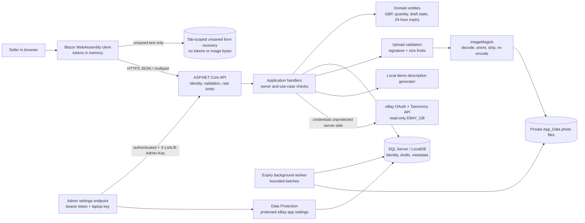
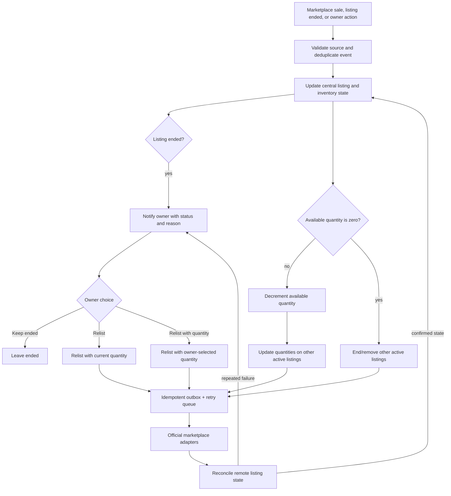

# ListLift

ListLift is a UK-focused product-listing assistant. It lets a seller create short-lived product drafts, add product facts and photos, generate a local demo description, and search eBay UK categories. It is a learning project and a local-development MVP; it is not ready for public registration or production deployment.

## Current scope

- ASP.NET Core Web API with ASP.NET Core Identity and a Blazor WebAssembly client.
- Authenticated, owner-scoped listing drafts stored in SQL Server. Drafts expire after 24 hours.
- Product facts, GBP pricing, quantity (defaults to 1), a local deterministic description suggestion, and image uploads.
- Unsaved form text is recovered from browser `sessionStorage` after a reload and sign-in in the same tab. It is account-scoped, cleared on sign-out, and never contains authentication tokens.
- JPEG, PNG, and WebP files are signature-checked, decoded, normalized, stripped of metadata, and stored privately outside the client web root.
- Read-only eBay UK taxonomy lookup and per-draft category selection. eBay Production credentials are currently unset.
- A laptop-bound administrator credential protects endpoints that configure eBay app credentials. Stored eBay credentials are protected with ASP.NET Core Data Protection.
- Local browser checks and four xUnit projects are included.

The app does **not** yet create or publish marketplace listings, connect to a real AI provider, show uploaded photo files, manage already-published listings, process payments, or provide seller-specific eBay authorization. Vinted publishing is not implemented; use only official marketplace access when that work begins.

## Solution layout

```text
ListLift.sln
├── src/
│   ├── ListLift.Domain/             # Product and listing rules
│   ├── ListLift.Application/        # Use cases and ports
│   ├── ListLift.Infrastructure/     # EF Core, files, image processing, eBay adapter
│   ├── ListLift.API/                # HTTP endpoints, Identity, auth and request policies
│   └── ListLift.Client/             # Blazor WebAssembly interface
├── tests/
│   ├── ListLift.DomainTests/
│   ├── ListLift.ApplicationTests/
│   ├── ListLift.InfrastructureTests/
│   └── ListLift.API.Tests/
├── tools/                           # Local DPAPI/admin-settings PowerShell helpers
├── MANUAL_BROWSER_CHECKLIST.md
├── PROJECT_PLAN.md
└── SECURITY_REVIEW.md
```

## Architecture and data flow

The client holds Identity access and refresh tokens only in its scoped in-memory session. It sends access tokens in the `Authorization: Bearer` header. Unsaved form text is separately held in tab-scoped browser storage for recovery; it is not an authentication mechanism. The API authenticates the caller, controllers route requests to Application handlers, handlers enforce use-case and owner rules, and Infrastructure persists data or calls fixed external services. The browser is not trusted to enforce validation or ownership.



### Request and endpoint map

All endpoints below are hosted by the API at the development base URL `https://localhost:7155`. Except for health and Identity account flows, application endpoints require a bearer token. Draft handlers scope reads and writes to the authenticated owner.

```mermaid
flowchart TD
    Browser[Blazor client]
    Health[GET /health]
    Auth[Identity endpoints under /auth]
    Drafts[Draft routes under /api/drafts]
    Categories[GET /api/categories/{marketplace}/suggestions]
    Admin[GET / PUT / DELETE /api/admin/ebay-settings]
    Authn[Identity token authentication]
    Owner[Owner-scoped application handlers]
    AdminGate[Authenticated account + laptop admin key]
    Data[(SQL Server + private photo storage)]
    Ebay[eBay GB Taxonomy]

    Browser --> Health
    Browser --> Auth
    Browser -->|Bearer token| Drafts
    Browser -->|Bearer token| Categories
    Browser -->|Bearer token + X-ListLift-Admin-Key| Admin
    Drafts --> Authn --> Owner --> Data
    Categories --> Authn --> Owner --> Ebay
    Admin --> Authn --> AdminGate --> Data
```

### HTTP endpoint reference

| Method and route | Access | Purpose |
|---|---|---|
| `GET /health` | Anonymous | Returns a minimal health status. It does not expose database or dependency details. |
| `POST /auth/register` | Anonymous | Creates an Identity account. Public registration is enabled for local development; paid access is not enforced. |
| `POST /auth/login?useCookies=false` | Anonymous | Signs in and returns bearer access/refresh tokens. |
| `POST /auth/refresh` | Refresh token | Exchanges a refresh token for a new token pair. |
| `GET /auth/confirmEmail` | Confirmation token | Identity email-confirmation endpoint; an email delivery workflow is not configured yet. |
| `POST /auth/resendConfirmationEmail` | Anonymous | Identity confirmation endpoint; delivery is not configured yet. |
| `POST /auth/forgotPassword` | Anonymous | Identity password-recovery endpoint; delivery is not configured yet. |
| `POST /auth/resetPassword` | Reset token | Identity password-reset endpoint. |
| `POST /auth/manage/2fa` | Authenticated | Identity two-factor management endpoint; the client does not yet provide a setup flow. |
| `GET /auth/manage/info` | Authenticated | Reads Identity account information. |
| `POST /auth/manage/info` | Authenticated | Updates Identity account information. |
| `POST /api/drafts` | Authenticated | Creates a draft using the current owner. Optional quantity defaults to 1. Returns `201 Created`. |
| `GET /api/drafts` | Authenticated | Lists the caller's active drafts. |
| `GET /api/drafts/{draftId}` | Authenticated | Reads one of the caller's drafts. |
| `PUT /api/drafts/{draftId}/facts` | Authenticated | Updates product name, category, condition, attributes, GBP price, and optional quantity. |
| `PUT /api/drafts/{draftId}/description` | Authenticated | Saves reviewed description text. |
| `POST /api/drafts/{draftId}/description/generate` | Authenticated | Generates a local demo suggestion; no external AI service is called. |
| `POST /api/drafts/{draftId}/photos` | Authenticated | Uploads one validated photo; maximum 10 photos per draft and 10 MiB per file. |
| `PUT /api/drafts/{draftId}/categories/{marketplace}` | Authenticated | Saves a selected marketplace category for the caller's draft. |
| `DELETE /api/drafts/{draftId}` | Authenticated | Deletes the caller's draft and its private photo files. |
| `GET /api/categories/{marketplace}/suggestions?query=...` | Authenticated | Searches category suggestions. eBay calls the read-only UK Taxonomy API; Vinted lookup is unavailable. |
| `GET /api/admin/ebay-settings` | Authenticated + laptop key | Returns only whether eBay settings are configured. It never returns the credentials. |
| `PUT /api/admin/ebay-settings` | Authenticated + laptop key | Protects and stores eBay Production app credentials server-side. |
| `DELETE /api/admin/ebay-settings` | Authenticated + laptop key | Removes stored eBay app credentials. |

`MapIdentityApi` also maps Identity account-management routes listed above. Their existence does not mean email delivery, account recovery, or a client 2FA workflow is production-ready. See [Microsoft's Identity API endpoint documentation](https://learn.microsoft.com/aspnet/core/security/authentication/identity-api-authorization?view=aspnetcore-10.0).

### Rate limits and error responses

- Authentication endpoints: 10 requests per minute per remote IP.
- General controller endpoints: 60 requests per minute per authenticated user, or remote IP when unauthenticated.
- eBay administrator routes: 5 requests per minute per remote IP, in addition to the controller policy.
- API validation and application failures use safe Problem Details responses. Typical statuses include `400`, `401`, `403`, `404`, `409`, `429`, and `503`.
- The photo endpoint does not currently provide a photo download or preview route.

## Security controls and limits

The current controls and the remaining pre-production gaps are documented in [SECURITY_REVIEW.md](SECURITY_REVIEW.md). In brief:

- Domain and request validation is server-side. EF Core LINQ queries parameterize values; do not concatenate user input into SQL.
- Product names and descriptions are stored as text and rendered through normal Razor bindings. Do not use `MarkupString` or inject raw user/AI HTML. Input stripping is not a substitute for context-aware output encoding.
- Photo uploads check size, declared media type, file signature, and decoded image dimensions. Supported files are re-encoded, metadata is stripped, random names are used, and files are stored under `src/ListLift.API/App_Data/ListingPhotos`, outside the client web root.
- Tokens are held in memory by the client and attached explicitly as bearer headers. A page reload signs the user out. No access or refresh tokens are placed in browser storage.
- Unsaved form text is saved in `sessionStorage`, under a key derived from the normalized account email, and restored after signing back in in the same tab. Sign-out clears it; closing the tab clears the session storage. It does not contain tokens or pending image bytes. Uploaded photos are already on the server; unuploaded photos must be selected again.
- API endpoints use Identity, authentication/authorization attributes, owner-scoped repository queries, rate limits, exact Development CORS origins, and safe Problem Details.
- The local admin credential is random and encrypted for the current Windows user by DPAPI. The API stores only its SHA-256 hash in User Secrets and compares hashes in constant time. eBay app credentials are protected with ASP.NET Core Data Protection before database storage.
- A Content Security Policy is present in the client HTML as a development defense. Production hosting still needs deliberate response security headers, HTTPS/HSTS, production CORS, persistent protected Data Protection keys, production database settings, account/payment controls, and per-user storage quotas.

The security review uses OWASP ASVS 5.0.0 as a verification checklist, relevant OWASP Cheat Sheets, and NIST SP 800-63B-4 as current password guidance. This is a source review and manual local walkthrough, **not** an external penetration test, certification, or claim of ASVS compliance. NIST recommends at least 15 characters for single-factor passwords and no character-class composition rules; ListLift's new-account policy follows that pattern. See the [NIST SP 800-63B-4 password requirements](https://pages.nist.gov/800-63-4/sp800-63b.html) and [OWASP ASVS](https://asvs.owasp.org/).

## Data and marketplace behavior

- Currency and display culture are UK-oriented (`GBP`, `en-GB`).
- Draft quantity defaults to `1`; the optional entry accepts values from 1 through 999,999. The server validates and persists the quantity with the draft.
- Unsaved text fields auto-save in the current tab to support reload/reconnect recovery. The server remains authoritative once the seller saves the draft.
- Draft data expires 24 hours after creation. A hosted worker scans in batches every five minutes, deletes private photo files, then deletes database rows. Cleanup after a long outage catches up in bounded batches.
- User uploads and product facts are not sent to an AI provider. The description generator is deterministic local demo code.
- eBay category lookup uses eBay Production app credentials through a server-side client-credentials flow and the `EBAY_GB` Taxonomy API. It does not publish listings or connect a seller's eBay account.
- Vinted is not integrated. Use manual preparation until official Vinted Pro API/ontology access is available.

## Local development

### Requirements

- Windows with .NET SDK 10.0.403 or a compatible .NET 10 SDK.
- SQL Server LocalDB for the checked-in Development connection string.
- The ASP.NET Core development certificate trusted on the local machine.

The Development connection string uses LocalDB and `TrustServerCertificate=True`; it is for local development only. The API's migration hosted service applies EF migrations only when `ASPNETCORE_ENVIRONMENT=Development`. Do not use this database configuration as a production template.

### Restore and build

Run from the repository root:

```powershell
dotnet restore .\ListLift.sln
dotnet build .\ListLift.sln --no-restore
```

The test suite is split by layer. To run it after a successful build:

```powershell
dotnet test .\ListLift.sln --no-build
```

The user confirmed a full-solution build, 37 passing tests, and a successful browser walkthrough after the form-recovery and quantity changes. Migration `20261110142117_AddListingDraftQuantity` was generated and applied. API tests exercise controllers and security metadata directly; end-to-end HTTP authentication-pipeline tests remain future work. See [MANUAL_BROWSER_CHECKLIST.md](MANUAL_BROWSER_CHECKLIST.md) for the verified flows.

For a local dependency vulnerability check, run:

```powershell
dotnet list .\ListLift.sln package --vulnerable --include-transitive
```

Do not interpret a failed restore/audit command as a clean vulnerability scan.

### Start API and client

Open two PowerShell terminals from the repository root.

API terminal:

```powershell
dotnet run --project .\src\ListLift.API\ListLift.API.csproj --launch-profile https
```

Client terminal:

```powershell
dotnet run --project .\src\ListLift.Client\ListLift.Client.csproj --launch-profile https
```

Open `https://localhost:7160`. The API health route is `https://localhost:7155/health`. Keep each terminal open while using the local app.

## eBay administrator setup (optional)

Basic draft, photo, and description work does not require eBay credentials. Do not put eBay secrets in `appsettings.json`, source code, browser configuration, chat, or Git.

When you intentionally enable eBay category search, initialize the laptop credential:

```powershell
powershell.exe -NoProfile -ExecutionPolicy Bypass -File .\tools\Initialize-ListLiftAdminCredential.ps1
```

This saves a Windows DPAPI-protected credential under `%LOCALAPPDATA%\ListLift` and writes only its SHA-256 hash to the API project's User Secrets store. To inspect status, set credentials, or remove them, use the same helper with the action `Get`, `Set`, or `Delete`:

```powershell
powershell.exe -NoProfile -ExecutionPolicy Bypass -File .\tools\Invoke-ListLiftAdminEbaySettings.ps1 -Action Get
```

The `Set` action prompts for Production keys; do not paste them into source control. The administrator settings endpoints require both an Identity bearer token and the laptop credential header. For production, the hash, Data Protection key ring, database, TLS termination, CORS origins, and administrator account must be provisioned using the later environment-specific deployment design.

## Current verification status

- The user confirmed a full-solution build and 37 passing tests after the password-policy, form-recovery, and quantity changes.
- Migration `20261110142117_AddListingDraftQuantity` was generated and applied to the Development LocalDB.
- Browser checks passed for GBP draft creation, persistence, encoded XSS-like text, SQL-like text treated as ordinary data, photo upload, demo description save, safe unavailable eBay lookup, draft deletion, and sign-out.
- eBay keys remain unset. No real AI or marketplace listing publication was tested.
- The local repository is on `main`, includes an MIT license, `.gitignore`, Dependabot configuration, and a GitHub Actions CI workflow. No GitHub remote is configured and the repository has not been published.
- The GitHub Actions workflow performs restore, a moderate-or-higher NuGet advisory check, Release build, and automated tests. Successful pushes can deploy the API and Blazor client to Azure Development or Production GitHub environments. Azure deployment remains disabled until repository variables `AZURE_DEV_DEPLOY_ENABLED` or `AZURE_PROD_DEPLOY_ENABLED` are set.
- Azure resource setup and free-tier constraints are documented in [AZURE_DEPLOYMENT.md](AZURE_DEPLOYMENT.md). Azure resources are not created, no GitHub remote is configured, and nothing has been pushed.

See [PROJECT_PLAN.md](PROJECT_PLAN.md) for the original phased project plan, [CI_CD_PLAN.md](CI_CD_PLAN.md) for the pipeline overview, [AZURE_DEPLOYMENT.md](AZURE_DEPLOYMENT.md) for portal and GitHub setup, and [NEXT_STEPS.md](NEXT_STEPS.md) for the current handoff.

ListLift is licensed under the MIT License. See [LICENSE](LICENSE).

## NEXT TO DEVELOP

This backlog tracks work beyond the current local MVP. GitHub CI and Azure deployment workflows are prepared; Azure deployment is disabled until resources and cloud storage/key persistence are ready.

1. **Publish and verify GitHub CI.** The local repository, MIT license, README, ignore rules, Dependabot, and CI workflow are prepared. Remaining: create the selected public repository, push `main` and `develop`, and review the first dependency audit and CI run.
2. **Configure Azure Development and Production.** Azure deployment jobs are implemented but disabled by default. Create the Development Azure resources and GitHub environment, add the documented OIDC and deployment values, complete the Blob/Data Protection prerequisites, and only then set repository variable `AZURE_DEV_DEPLOY_ENABLED=true`. Keep `AZURE_PROD_DEPLOY_ENABLED` false until a paid suitable tier and production hardening are ready.
3. **Paid access and account lifecycle.** Add payment webhooks and server-side entitlement checks before granting app access; configure email confirmation and password recovery delivery; decide on an owner/admin role and account-binding for eBay settings; implement and expose MFA/strong recovery before public registration.
4. **Resource-abuse limits.** Add per-user draft, photo count/byte, and upload-rate quotas so many drafts cannot exhaust storage; monitor cleanup and add retention/backup policies.
5. **Production hardening.** Enforce HTTPS/HSTS and response security headers at the app or trusted edge, set exact production CORS, configure forwarded headers, use a production SQL service, and persist/protect/backup Data Protection keys. Do not ship LocalDB or `TrustServerCertificate=True`.
6. **Verify the 24-hour lifecycle in runtime.** Exercise cleanup after expiry, restart recovery, and failure/retry behavior using a controlled test clock or dedicated integration test.
7. **End-to-end API and browser automation.** Add tests that run the HTTP authentication pipeline, prove anonymous requests fail and cross-owner IDs are denied, and automate key browser flows.
8. **Photo retrieval and user experience.** Add an authorized photo read/preview route with safe response headers and owner checks; current UI stores photo metadata/count only. Browser recovery does not retain unuploaded photo bytes.
9. **Real AI description provider.** Add a server-side provider, protected credentials, timeouts/rate limits, prompt/data boundaries, cost controls, and a seller review step. Keep factual claims grounded in supplied product details.
10. **Manage listing lifecycle across marketplaces.** Track external listing IDs, status, quantity, and order/sale events. Notify the owner when a listing ends and offer choices to leave it ended, relist, or relist with a chosen quantity. When an item sells out on one marketplace, deactivate/remove the remaining active listings on connected marketplaces; if stock remains, synchronize quantities instead. Use official seller-authorized APIs, idempotency, an outbox/retry queue, and reconciliation so partial failures do not leave stale duplicate listings.
11. **Official marketplace listing integration.** Add seller-specific eBay authorization and approved Vinted Pro access before creating, updating, ending, or relisting real marketplace listings. Vinted remains manual until approved access is available.

Projected listing-lifecycle and cross-market stock synchronization flow (not implemented yet):


